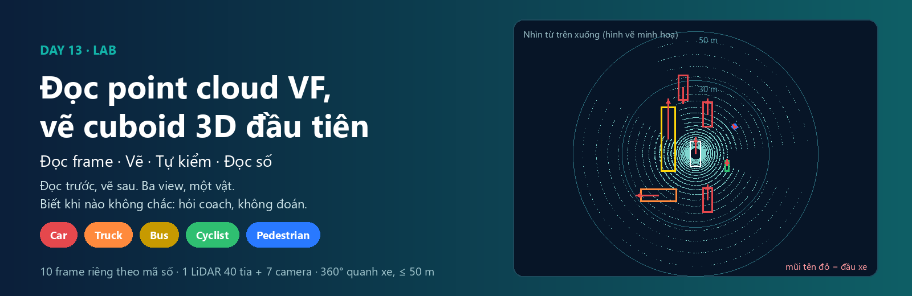
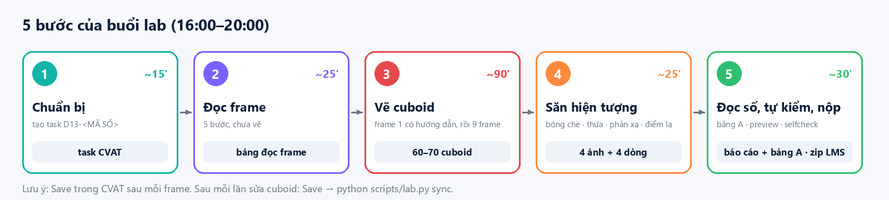
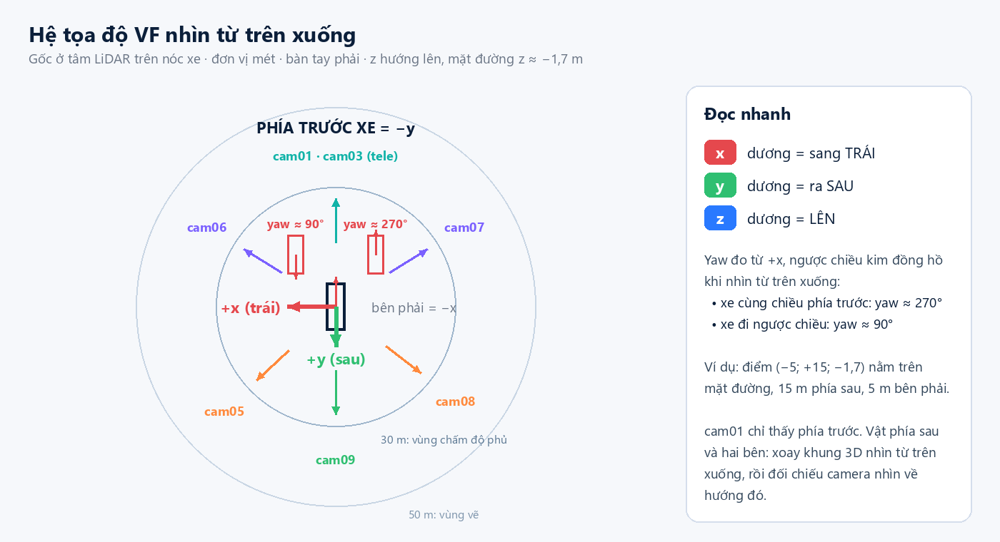

  

# Day 13 Lab — Đọc point cloud VF và vẽ cuboid 3D đầu tiên

  
  
  
  
  
  

Bạn sẽ đọc **10 frame LiDAR** của bộ VF, vẽ cuboid trong CVAT và dùng Bảng A để kiểm tra hướng, kích thước và độ cao đáy hộp.

Trong vùng 360° quanh xe thu dữ liệu, chọn các vật cách LiDAR tối đa 50 m. Ưu tiên xe và người ở gần, có cụm điểm rõ. Ghi lại bốn hiện tượng ảnh hưởng đến việc gán nhãn và các trường hợp bạn còn chưa chắc.

Công cụ đã **viết sẵn** (`cvat_lab/`, `scripts/`): tạo task, xuất bảng A, chiếu cuboid lên ảnh camera, soát cuboid bằng point cloud. Bạn không viết code; bạn tập trung vào **đọc point cloud và vẽ cho đúng**.
Cuboid hôm nay là hình đơn lẻ trên từng frame (Shape), không phải track. Track và nội suy là nội dung Ngày 24–26.

## Bộ dữ liệu

Dữ liệu VF gồm 5 đoạn ghi liên tục (sequence). Mỗi đoạn có 60 frame, cách nhau 1 giây. Mỗi frame gồm một point cloud từ LiDAR 40 tia và 7 ảnh camera chụp cùng thời điểm.

Script chọn **10 frame cố định theo mã số**, hai frame mỗi sequence, cách nhau ít nhất 15 giây. Hai học viên có thể trùng một số frame. Giảng viên gửi riêng link tải và mật khẩu giải nén. Tải và giữ dữ liệu trên máy của bạn. [Cấu trúc dữ liệu VF](data/README.md)

## Bắt đầu nhanh (5 bước, ~4 giờ)

0. **Trước buổi học**, chọn **Use this template** trên GitHub để tạo repo **public** theo [quy định đặt tên repo học viên](SUBMISSION.md#tên-repo). Clone repo của bạn, cài môi trường và CVAT, rồi tải dữ liệu. Điền `configs/lab.ini` và chạy `python scripts/lab.py dry`. Kết quả cần có **10 frame, mỗi frame `camera=7`**. [Hướng dẫn cài đặt và push thử](docs/SETUP.md) · [Cài CVAT](docs/CVAT_SETUP.md)
1. **Chuẩn bị**: `python scripts/lab.py task` tạo task `D13-<MÃ SỐ>`; `python scripts/lab.py task --code <MÃ CHUNG>` tạo task chung cho vòng hiệu chuẩn ([GUIDE.md](GUIDE.md)).
2. **Đọc frame** theo năm bước trên 2 frame đầu, chưa vẽ.
3. **Vẽ ít nhất 53 cuboid**. Vẽ ít nhất 8 ở frame đầu và 5 ở mỗi frame sau. Mục tiêu khuyến nghị là 60–70 hộp. [Quy tắc vẽ cuboid](docs/GUIDELINE.md)
4. **Tìm bốn hiện tượng ảnh hưởng đến việc gán nhãn** gồm bóng che, điểm thưa ở xa, phản xạ thấp hoặc ít điểm bất thường, và điểm lạ. [Cách tìm và ghi lại hiện tượng](docs/PHENOMENA.md)
5. Bấm **Save** trong CVAT rồi chạy `python scripts/lab.py sync` để kiểm hộp. Sau khi sửa hộp, bấm **Save** và chạy lại `sync`. Dùng số liệu mới để hoàn thành báo cáo, đóng gói ảnh và kiểm bài nộp. Commit, push rồi nộp **link repo** và **ZIP ảnh** lên LMS trước **23:59 GMT+7 ngày làm lab**. [Các bước nộp bài](SUBMISSION.md#trước-khi-nộp)

> **Khi nộp**, đổi tiêu đề README thành `# Day 13 Lab — <MSSV> - <Họ và tên>`. Đổi tên báo cáo `report/individual/MSSV_HoTen.md` thành `<MSSV>_<HoTen>.md` (ví dụ `2A202600123_NguyenVanAn.md`).
> `<MÃ SỐ>` và `<MSSV>` trong tài liệu là một: mã số của bạn, đúng như dòng `student` trong `configs/lab.ini`.
> Mọi lệnh `python scripts/lab.py ...` chạy **giống nhau trên Windows và macOS**. macOS có thêm lệnh tắt `make` ([Makefile](Makefile)). Lệnh riêng từng hệ điều hành (cài đặt, kích hoạt môi trường, mở file): [docs/COMMANDS.md](docs/COMMANDS.md).

<b>Vì sao tối thiểu 8/5 mà lại khuyên vẽ 10/6?</b>

Độ phủ tính theo số vật trong 30 m được ghép với cuboid bạn vẽ. Hãy ưu tiên các vật gần và căn hộp sát cụm điểm. Vẽ khoảng 10 hộp ở frame đầu và 6 hộp ở mỗi frame sau để có thêm cơ hội bao phủ các vật rõ. [Cách tính độ phủ](RUBRIC.md)

<b>Máy yếu / không chạy được Docker / CVAT không chiếu cuboid lên ảnh?</b>

- Máy 8 GB RAM: dùng `cvat/docker-compose.lowspec.yml` ([docs/CVAT_SETUP.md](docs/CVAT_SETUP.md) mục 6).
- Không chạy nổi Docker: báo coach để ngồi ghép đôi. Mỗi người vẫn một tài khoản CVAT, một task và một repo riêng ([docs/CVAT_SETUP.md](docs/CVAT_SETUP.md) mục 6, Ngồi ghép đôi).
- CVAT 2.82/2.83 của lớp không chiếu cuboid lên ảnh camera (không có "biểu tượng vàng" như trong bản guideline .docx). Dùng `python scripts/lab.py preview` để xem cuboid của bạn trên 7 ảnh camera.
- Không có chuột: vẽ cuboid 3D bằng touchpad rất chậm. Mang chuột có con lăn.

## Bạn sẽ có gì sau bài này

| Sản phẩm | Ở đâu |
|---|---|
| Task CVAT `D13-<MÃ SỐ>` với 60–70 cuboid đã Save | CVAT trên máy bạn |
| **Bảng A**: 7 tham số, khoảng cách, đáy cuboid của từng cuboid | `submission/D13-<MÃ SỐ>-bangA.csv` (commit vào repo) |
| **Phiếu tự kiểm**: số điểm trong cuboid, khoảng hở với mặt đường, cảnh báo | `submission/D13-<MÃ SỐ>-tukiem.csv` (commit vào repo) |
| 11 ảnh chụp màn hình (đọc frame, cuboid mẫu, bốn hiện tượng) | `report/individual/images/` (nén bằng `pack`, nộp LMS, không commit) |
| **Một báo cáo duy nhất**: đọc frame, cuboid mẫu, bốn hiện tượng, số đo, điều còn chưa chắc | `report/individual/<MSSV>_<HoTen>.md` (commit vào repo) |

## Tài liệu

| Bạn cần | Xem |
|---|---|
| Các bước làm việc, lệnh, mốc giờ | [GUIDE.md](GUIDE.md), [CHECKPOINTS.md](CHECKPOINTS.md) |
| Quy tắc, giữ dữ liệu trong lớp, dùng AI | [RULES.md](RULES.md) |
| Chấm điểm | [RUBRIC.md](RUBRIC.md) |
| Nộp bài | [SUBMISSION.md](SUBMISSION.md) |
| Dữ liệu VF: tải, cấu trúc, phạm vi dùng | [data/README.md](data/README.md) |
| Cài Git, Python, thư viện, tải dữ liệu (Windows và macOS) | [docs/SETUP.md](docs/SETUP.md) |
| Cài CVAT trên máy, máy yếu, tạo task bằng tay, mẹo giao diện 3D | [docs/CVAT_SETUP.md](docs/CVAT_SETUP.md) |
| **Mọi lệnh của buổi lab**, Windows và macOS | [docs/COMMANDS.md](docs/COMMANDS.md) |
| Hệ tọa độ VF, 7 tham số, hướng 7 camera | [docs/COORDINATES.md](docs/COORDINATES.md) |
| Tóm tắt guideline: 5 class, quy tắc cuboid, bảng 4.3 | [docs/GUIDELINE.md](docs/GUIDELINE.md), [bản đầy đủ (.docx)](docs/3D_Cuboid_Annotation_Guideline.docx) |
| Bốn hiện tượng ảnh hưởng đến việc gán nhãn và frame gợi ý | [docs/PHENOMENA.md](docs/PHENOMENA.md) |
| Đọc `preview`, cờ của `selfcheck`, cột của bảng A | [docs/SELF_CHECK.md](docs/SELF_CHECK.md) |
| Lỗi hay gặp và cách tự gỡ | [docs/COMMON_ERRORS.md](docs/COMMON_ERRORS.md) |
| 5 nhãn cuboid để tạo task bằng tay | [cvat/labels.json](cvat/labels.json) ([docs/CVAT_SETUP.md](docs/CVAT_SETUP.md) mục 7) |

Slide tham khảo: **Day 13 — LiDAR, point cloud và nhãn 3D**. Nền tảng: Ngày 12 (cài CVAT local). Gán nhãn chính thức theo track: Ngày 24–26.

## Bạn học được gì

- **Mở và dùng được** CVAT 3D: đổi góc nhìn, vẽ và chỉnh cuboid, bật mũi tên hướng, đối chiếu ảnh camera.
- **Đọc** một frame LiDAR: gốc và trục (x trái, y sau, z lên), mặt đất, tầm nhìn, và cái gì chỉ camera hay chỉ LiDAR cho biết.
- **Vẽ** cuboid 7 tham số đúng class, mũi tên chỉ đầu xe, đáy chạm đường, khớp ở cả Top, Side, Front.
- **Nhận ra** chỗ point cloud không đáng tin (bóng che, thưa ở xa, phản xạ thấp, điểm lạ) và biết khi nào **không đoán**.
- **Kiểm bằng số**: đọc bảng A, so với bảng kích thước, và báo cáo trung thực cả những cuboid còn chưa chắc.

Hình trong `docs/assets/` là hình vẽ minh hoạ do lab coach tạo bằng `docs/assets/make_figures.py`, không chứa dữ liệu VF.

## Góp ý bài lab (30 giây)

Làm xong, dành 30 giây góp ý để bài lab sau tốt hơn: **[mở form góp ý](https://docs.google.com/forms/d/e/1FAIpQLSd8Mh7YkGEn-hnaePgbli4KqJ8-rkzCrFOIjr3YyCcrDs1UHA/viewform?usp=publish-editor)**.

- Chọn đúng lớp của bạn: **L2 · Day13** hoặc **L3 · Day13**.
- Form không hỏi họ tên, email hay MSSV.
