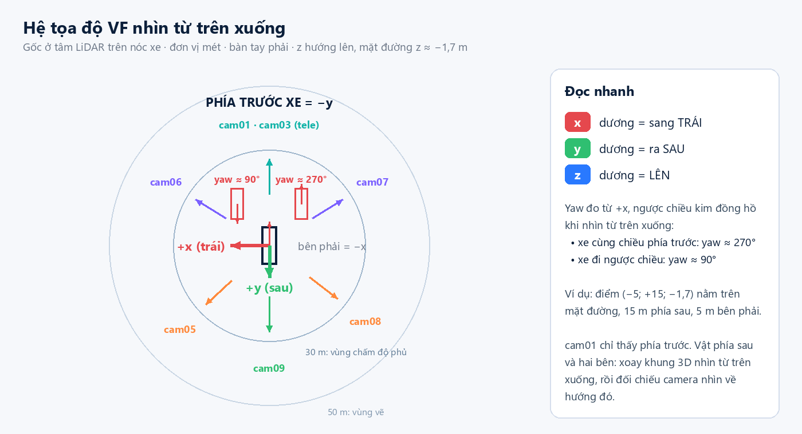

# Hệ tọa độ VF, cuboid 7 tham số, camera

## 1. Hệ tọa độ VF

Gốc ở tâm LiDAR trên nóc xe, đơn vị mét, bàn tay phải.

| Trục | Chiều dương | Ghi nhớ |
|---|---|---|
| x | sang **trái** | bên phải xe là −x |
| y | ra **sau** | phía trước xe là **−y** |
| z | **lên** | mặt đường khoảng z = −1,7 m (LiDAR cao khoảng 1,7 m) |

Ví dụ: điểm (x, y, z) = (−5; +15; −1,7) nằm trên mặt đường, 15 m phía sau và 5 m bên phải.

Hệ này khác KITTI và ROS (x tiến, y trái). Nếu bạn đã quen hệ khác, kiểm lại bằng ảnh cam01: cam01 nhìn về phía trước xe, tức hướng −y. Bản data-VF trước 22/11/2026 dùng hệ trục cũ; `python scripts/lab.py dry` tự phát hiện bản cũ ([COMMON_ERRORS.md](COMMON_ERRORS.md) mục 2).

## 2. Cuboid 7 tham số

`(cx, cy, cz, l, w, h, yaw)`: tâm cuboid; dài (dọc theo hướng yaw), rộng, cao; yaw quanh trục z, đo từ +x (trái), ngược chiều kim đồng hồ nhìn từ trên.

Vạch đỏ ngắn trong CVAT là `+X` của cuboid và xoay theo hộp. Với xe hướng thẳng cùng chiều xe thu dữ liệu, vạch này chỉ theo `−Y` của hệ VF, tức ngược chiều vạch xanh lá dài trong cảnh.

- Xe cùng chiều phía trước: yaw ≈ **270°**.
- Xe đi ngược chiều: yaw ≈ **90°**.

## 3. Camera

| Camera | Nhìn về |
|---|---|
| cam01, cam03 | phía trước (cam03 là ống tele) |
| cam06 | trước-trái |
| cam07 | trước-phải |
| cam05 | sau-trái |
| cam08 | sau-phải |
| cam09 | phía sau |

LiDAR phủ 360°, mỗi camera chỉ phủ một hình quạt, và giữa các hình quạt có góc mù. **Vật phía sau và hai bên không có trong ảnh cam01**: tìm chúng khi xoay khung 3D nhìn từ trên xuống, rồi đối chiếu camera nhìn về hướng đó.

Bảng trên là **hướng nhìn** (trục quang), tính từ `calib.json` của cả 5 sequence và đã đối chiếu trên ảnh camera. Đừng suy hướng nhìn từ sơ đồ camera của bộ VF: camera hai bên được lắp chéo, ví dụ cam07 gắn ở phía sau bên phải nhưng nhìn về phía trước bên phải, cam08 gắn ở phía trước bên phải nhưng nhìn về phía sau bên phải. Sơ đồ đặt CAM_8 ở trước-phải và CAM_7 ở sau-phải, nên đọc sơ đồ như hướng nhìn thì sẽ nhầm hai camera này. Khi tìm vật, dùng bảng hướng nhìn ở trên.

Tự kiểm trên một frame bất kỳ: một xe ở phía trước bên phải trên ảnh nhìn từ trên xuống, cách xe thu dữ liệu vài mét trở lên, thì hiện trong ảnh cam07; xe ở phía sau bên phải thì hiện trong ảnh cam08.
